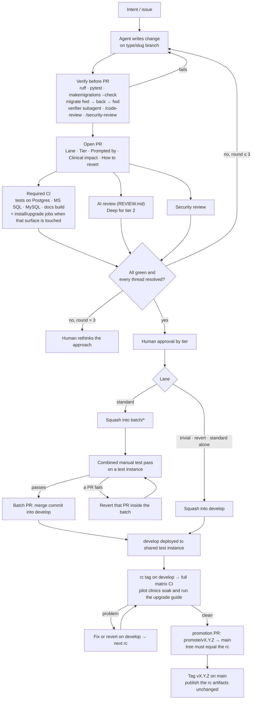
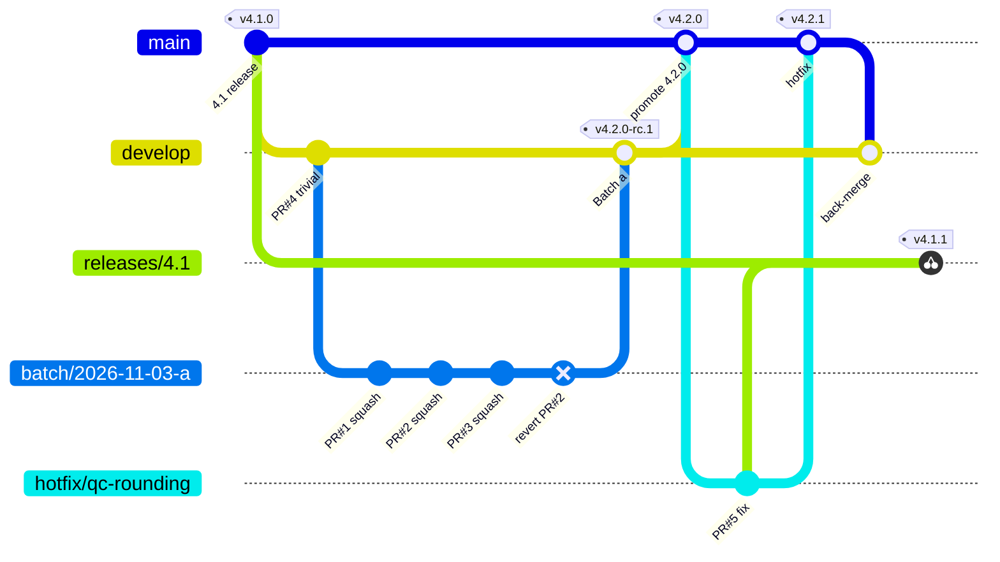
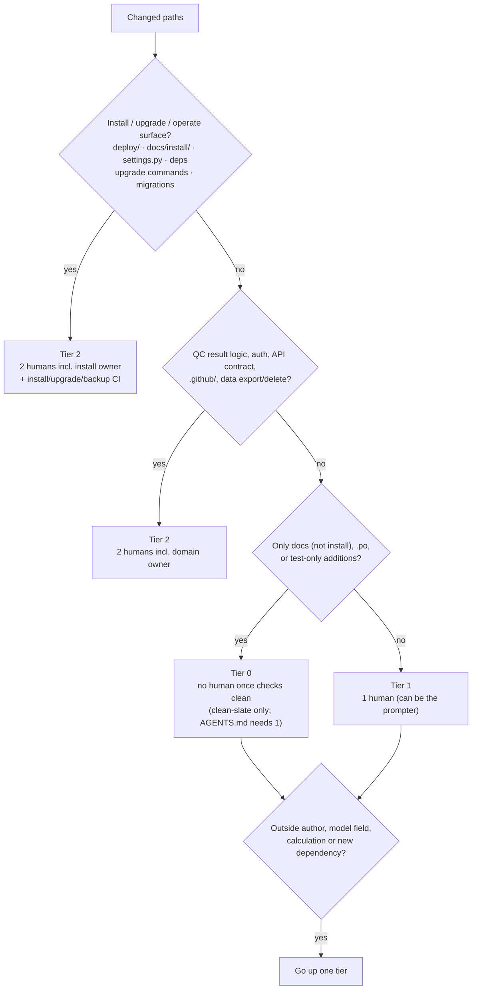
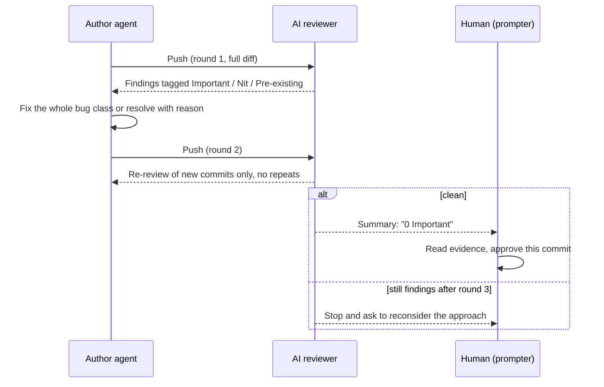
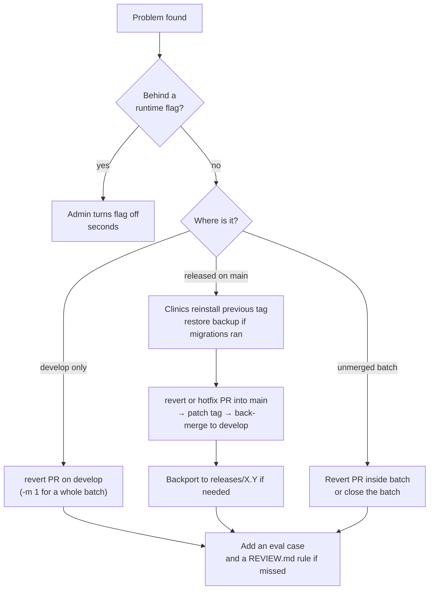

# Agent workflow diagrams

Visual companion to [discoveries.md](discoveries.md). Proposed workflow, not in use yet.
Branch model: `develop` integrates batches; `main` is the safe branch users install from.

## 1. Life of a change

## 2. Branches: develop, main, batches, hotfix and backport

- Only `promotion`, `hotfix` and `revert` PRs reach `main`; every commit on
  `main` carries a release tag.
- The promotion's tree must equal the `rc` tree, so clinics get exactly what
  the pilots tested.
- A hotfix on `main` is back-merged into `develop` the same day; CI on
  `develop` stays red until `main` is an ancestor of it again.
- `git revert -m 1 <Batch a>` undoes a whole batch on `develop`;
  `git revert <PR#1 squash>` undoes one member.
- `releases/4.1` starts from the `v4.1.0` tag and only takes `cherry-pick -x`
  of commits already on `main`.

## 3. Which risk tier?

## 4. Review loop with a round cap

## 5. Rollback ladder (fastest safe first)

